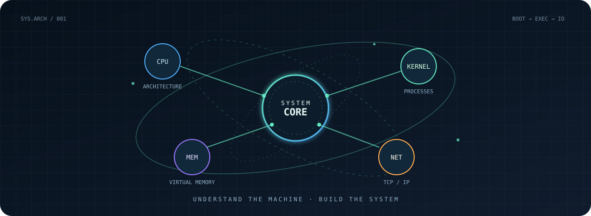
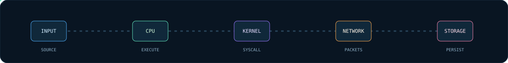

<div align="center">



# Shridatta Dixit

### `Computer Systems · Systems Software · Infrastructure`


[](https://arceus-systems.vercel.app/)
[](https://github.com/shridattadixit06)
[](https://www.linkedin.com/in/shridatta-dixit/)

</div>

---



## `01 / SYSTEM PROFILE`

I'm a Computer Science and Engineering student at **BMS College of Engineering** interested in the machinery beneath software.

I enjoy working close to the system boundary: understanding how a machine boots, how a process becomes a running program, how data moves through file descriptors and sockets, and how storage systems turn bytes into something reliable.

My approach is simple:

> **Understand the mechanism. Implement a small version. Test the edges. Inspect what actually happens.**

My current technical direction is **systems software and infrastructure engineering**, with a strong interest in operating systems, computer architecture, networking, and storage.

## `02 / THE SYSTEMS MAP`

<div align="center">

| Layer | What I explore |
|:--|:--|
| `01 · MACHINE` | x86 architecture, assembly, boot process, memory hierarchy |
| `02 · KERNEL` | Processes, system calls, interrupts, virtual memory, scheduling |
| `03 · RUNTIME` | C/C++, linking, loading, file descriptors, concurrency |
| `04 · NETWORK` | TCP/IP, sockets, protocol design, I/O multiplexing |
| `05 · STORAGE` | Filesystems, durability, indexing, database internals |
| `06 · DISTRIBUTED` | Replication, consistency, fault tolerance, coordination |

</div>

## `03 / PROJECTS UNDER THE HOOD`

These projects reflect the areas I'm actively exploring. The descriptions below are intentionally scoped to implemented or discussed prototypes—not claims of production readiness.

### `ARCEON` — Experimental x86 operating system

**C · NASM · x86 · BIOS · QEMU**

An educational OS project built to understand the boot path and the transition from firmware execution to a 32-bit kernel.

- Real Mode to Protected Mode transition
- BIOS disk loading and kernel handoff
- GDT, segment setup, and 32-bit stack
- Assembly-to-C kernel entry
- Interrupt and exception handling work
- VGA text output and QEMU-based development

[View Arceon repository](https://github.com/shridattadixit06/Arceon-0.2)

### `MYTRACE` — Linux system-call tracer

**C · Linux · `ptrace`**

A low-level exploration of how user programs interact with the Linux kernel.

- Observe system-call entry and exit
- Inspect process registers and syscall arguments
- Examine return values and process behaviour
- Learn by comparing traced execution with normal execution

### `UNIX SHELL` — A small shell in C

**C · POSIX APIs · Processes · IPC**

A modular UNIX-like shell for learning process management and command execution.

- Process creation and execution with `fork()` and `execvp()`
- Waiting and child-process handling
- Pipelines using `pipe()` and `dup2()`
- Input/output redirection
- Background execution and signal handling
- Builtins and modular project structure

### `ATLAS` — TCP file-storage prototype

**C · TCP sockets · File I/O**

A client-server storage prototype exploring the path from a network request to persistent file operations.

- `LIST`, `READ`, and `WRITE` request flow
- Buffered client-server communication
- Storage and metadata components
- Temporary-file writes and atomic rename-based updates
- Exploring durability, protocol correctness, and failure handling

### `FLUXDB` — Memory-centric database exploration

**Database internals · Data layout · Memory locality**

An early-stage idea exploring how memory layout, indexing, and locality influence data access. This is a research direction, not a claim of a completed database engine.

---

## `04 / CURRENT TOOLCHAIN`

<div align="center">


</div>

**Systems:** C, C++, Linux, UNIX system calls, x86 assembly, NASM  
**Build & debug:** GCC, Make, GDB, GNU Binutils, QEMU, Git  
**Networking & storage:** TCP sockets, `select()`, `poll()`, file I/O, MySQL  
**Other:** Python, JavaScript, HTML, CSS

## `05 / CURRENT RESEARCH RADAR`

Topics I keep returning to:

- Kernel architecture, interrupts, and process execution
- Microkernels, IPC, and communication overhead
- Memory management and computer architecture
- TCP behaviour and network I/O
- Filesystem semantics, crash consistency, and storage engines
- Database indexing, memory locality, and low-latency systems
- Tracing, profiling, and performance analysis

I'm especially interested in learning from real implementations and systems papers, then validating ideas with small experiments.

## `06 / HOW I WORK`

```text
READ THE DESIGN
      |
      v
BUILD A SMALL MODEL
      |
      v
RUN IT AND TRACE IT
      |
      v
BREAK EDGE CASES
      |
      v
DEBUG + MEASURE
      |
      v
DOCUMENT THE TRADE-OFFS
```

I value understandable implementations, reproducible tests, careful debugging, and honest documentation of limitations.

## `07 / ON THE BENCH`

Currently strengthening my foundations across:

- Computer systems and architecture
- Operating systems and Linux internals
- Data structures and algorithms
- Networking and database fundamentals
- Systems project testing, documentation, and reliability

Long term, I want to work on the infrastructure that other software depends on—and eventually build systems of my own.

## `08 / FIND ME`

<div align="center">

**Have an interesting systems problem, project, or research direction? Let's talk.**

[](https://arceus-systems.vercel.app/)
[](https://github.com/shridattadixit06)
[](https://www.linkedin.com/in/shridatta-dixit/)

<sub>Learning the machine, one layer at a time.</sub>

</div>
