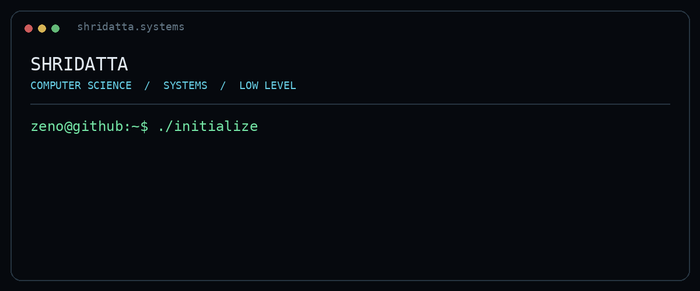

# `SHRIDATTA DIXIT`

<p align="center">
  
</p>

<p align="center">
  <b>Computer Science • Operating Systems • Computer Architecture • Systems Programming</b>
</p>

<p align="center">
  <a href="https://github.com/shridattadixit06">GitHub</a>
  &nbsp; • &nbsp;
  <a href="https://www.linkedin.com/in/shridatta-dixit/">LinkedIn</a>
</p>

---

## `whoami`

```text
NAME        Shridatta
FIELD       Computer Science
INTERESTS   Operating Systems
            Computer Architecture
            Systems Programming
            Linux / UNIX
            Low-level Software
            Systems Research
```

I like understanding computers from the bottom up — not just **what** software does, but **how the machine makes it happen**.

---

### Building

**Arceon** — an educational x86 operating system.

Alongside it, I'm exploring shells, system calls, networking, tracing, and the mechanisms that connect software to the machine.

---

## `toolchain`

<p align="center">
  
</p>

```text
LANGUAGES       C • C++ • Assembly
SYSTEMS         Linux • UNIX
TOOLS           GCC • GDB • Make • Git
DOMAINS         OS • Architecture • Networking
```


<p align="center">
  <code>currently somewhere between userspace and the kernel.</code>
</p>
